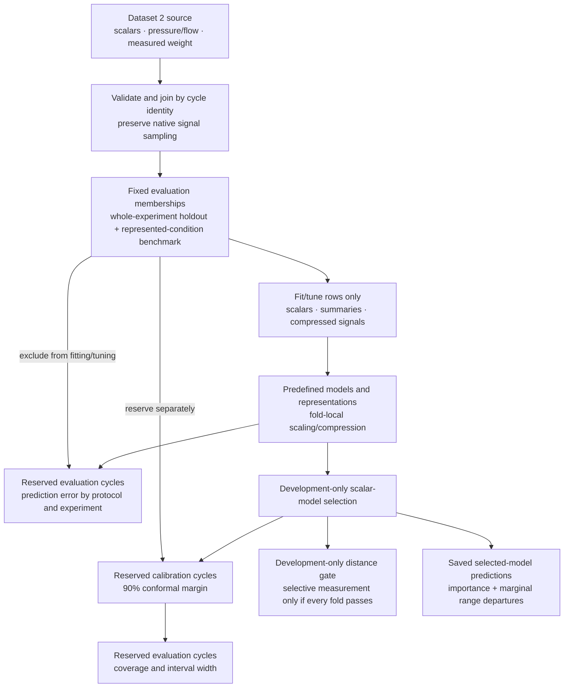

# M10 — Portfolio report and offline dashboard

**Status:** complete.

## Purpose

Give a new reader a runnable account of the Dataset 2 study: what was measured,
how prediction was evaluated, what transferred and what did not. The HTML report
and dashboard present saved evidence rather than running another modeling experiment.
The [hosted HTML case study](https://stevennitesh.github.io/manufacturing-process-intelligence/)
is the primary reading path for outside reviewers, with an
[offline copy](../report/index.html). The dashboard provides additional local views.
The [specification](../spec.md#explanation-dashboard-and-release) owns scientific
scope; [M7](m07-uncertainty-and-shift.md) and
[M9](m09-predictive-explanation.md) own uncertainty and explanation methods.

## Implementation

One local Streamlit application with Plotly figures reads the prepared bundle and
saved M4–M7/M9 artifacts. It does not train models, download data or write artifacts.
Missing-input guidance lists acquisition, preparation and analysis commands in order,
to run from the repository root. The [reproduction guide](../reproduction.md) owns
setup, CLI and reproduction instructions; the README leads to that guide.

The static report uses the dashboard's evidence loader and aggregations. Its small
renderer reads existing saved predictions, metrics and run records, then embeds
aggregate charts, semantic tables and styles in one portable HTML file, and exports
the same scalar comparisons as an attributed SVG for the GitHub front page. Rendering
does not refit models or refresh sources. Source archive and membership hashes
remain visible in the report; full numeric run artifacts remain ignored. The
README leads to this report before local setup. The template's interpretation is
specific to the completed study and needs editorial review if the analysis changes.

The [Pages workflow](../../.github/workflows/pages.yml) publishes only the committed
report as the site entry point. Deployment requires successful CI on the same
current `main` commit. Publishing does not acquire data or regenerate analysis.

- **Data & process:** cycle/part linkage, experiment differences, weight distributions,
  and median pressure/flow profiles with the middle 80% and optional full observed
  range. Native timestamps are preserved; unconfirmed signal units remain explicit.
- **Prediction & generalization:** the default comparison uses two evaluation settings
  with the same cycle weighting, followed by trajectory benefits and per-experiment
  predictions. Equal-experiment metrics and aggregate representation comparisons remain
  in detail. Independently selected uncertainty-model importance has its own expander.
- **Reliability under shift:** measured interval coverage, calibration populations,
  interval examples, development screening and marginal training-range departures.
  The screening table names both the excluded experiment and the development
  experiments actually screened. Failed screening does not produce a measurement policy.

Displayed quantities and conditional conclusions follow loaded evidence. The loader
checks common source/membership identity and the exact M7 files referenced by M9.
It caches evidence with an explicit reload control; it is not an artifact registry.
Observed/predicted plots use a common padded axis range and equal physical scale.

### Technical study flow

Fitting, scaling, compression and tuning stay within permitted development rows.
Separate calibration rows come from represented experiments, not the omitted one.
Primary and represented-condition comparisons use separately fitted pipelines.
Equal-experiment MAE remains the predefined scientific summary; pooled MAE gives
each evaluated cycle equal weight. Initial exploration inspected all experiments,
so the study is retrospective, not prospective confirmation.

## Verification

The dashboard suite covers aggregation, cycle identity, small nonzero coverage,
source/membership consistency, M7 references, recovery ordering, screening populations,
equal plot geometry and conclusions that change with synthetic results. Full training
is excluded from CI. Real saved-data smoke tests and browser inspection exercise the
ordinary reader workflow; tracked previews show representative views.

The presentation update passed all 108 tests, Ruff lint/format, Pyright and CLI
smoke. The report tests independently check unequal-group aggregation, interval
coverage precision, selected model families, escaping and aggregate-only output.
Real saved-data report rendering reproduced the HTML byte for byte. Its displayed
MAE, group means, interval counts/widths and screen decisions agree with independently
recalculated saved evidence. Browser inspection at 1440 × 1000 and 390 × 844 verified
legibility, section links, expandable evidence and table access without page-wide
horizontal overflow. Charts need no external assets or JavaScript. Dashboard
previews show the [overview](../images/dashboard-overview.jpg),
[prediction comparison](../images/dashboard-prediction.jpg) and
[interval reliability](../images/dashboard-reliability.jpg).

## Consolidated interpretation

The dashboard makes the central study conclusion visible: low prediction error with
represented conditions did not establish reliable transfer to an omitted experiment.
Trajectory additions were inconsistent; calibration from familiar conditions did not
provide reliable coverage under shift. The development distance screen failed its
predefined criterion, so M8 was skipped and no selective-measurement policy is claimed.

These are three controlled transfer scenarios, not a universal manufacturing result.
Input-range departures are not causal explanations or full multivariate support.
Permutation importance is population-specific and complicated by correlated inputs.
There are no authoritative product tolerances or verified production chronology.
The app is a local reader of current artifacts, not a deployed service or compatibility
layer. Model settings and saved scientific results remain unchanged.

## Next step

The completed MVP supports portfolio presentation. Future work should test broader
labeled operating conditions, whole-condition validation and recalibration before
considering measurement assistance. Detailed future monitoring proposals remain in
this milestone and the scientific specification; the roadmap owns subsequent scope.

### Proposed measurement-assistance follow-up

Expand the labeled operating envelope: sample supported condition ranges and
combinations across material lots, recipes, machines and settings. Compare broader
condition coverage with more cycles from familiar conditions; this study did not
compare those collection strategies. Keep whole-condition, lot or machine holdouts.
Measure unsupported cases physically and evaluate errors, interval coverage and
recalibration prospectively before automating any measurement choice.

An input-drift warning means the model may be outside its validated use, not that
the part is defective. Data quality, context and input-distribution changes could
be checked when inputs arrive. Performance and calibration drift require later
measured weights. The source lacks authoritative wall-clock chronology, so it
cannot validate temporal drift detection or warning delay.

A future workflow could distinguish represented, boundary/warning and unsupported
operation. Development data must set thresholds and prospective evidence must
validate them. An intended-use contract would need to specify machine, mold,
material, target, inputs/units, supported envelope, validated performance,
calibration date, measurement policy and refusal rules. These are proposals,
not capabilities demonstrated by the completed study.
